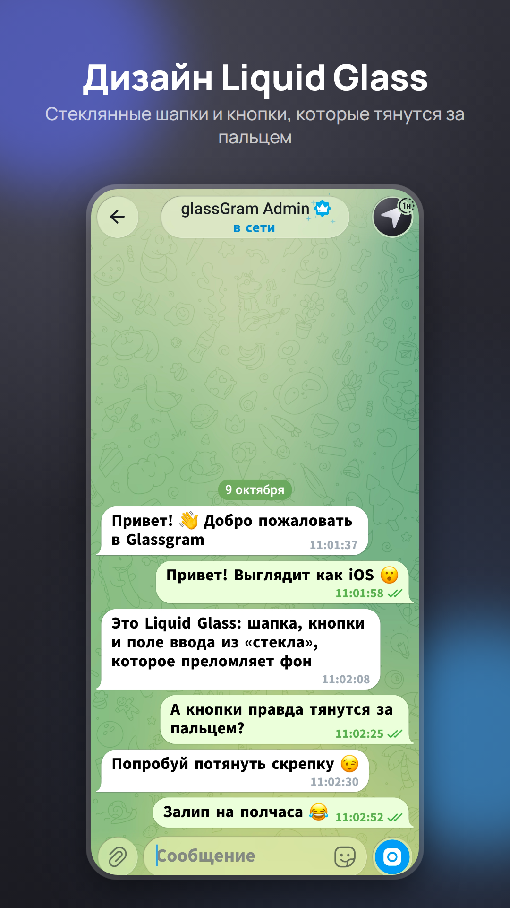
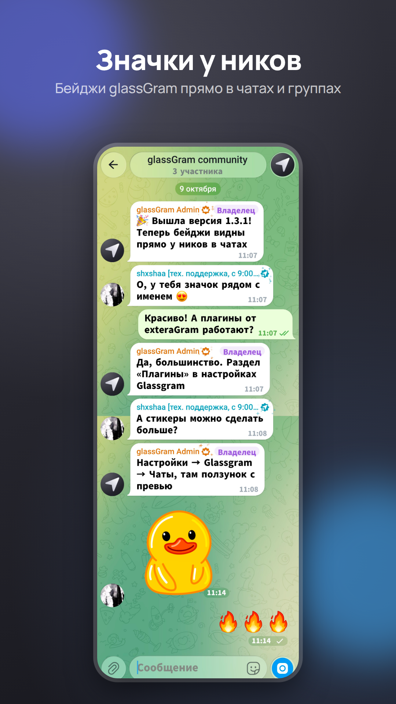
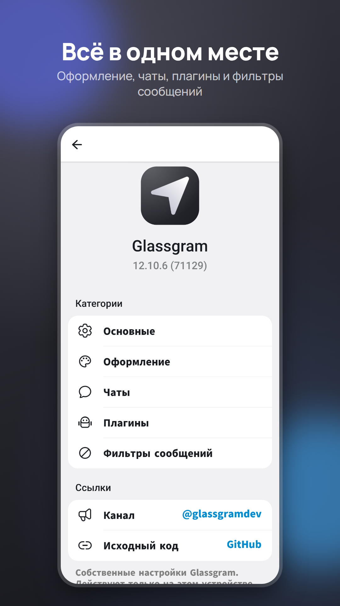
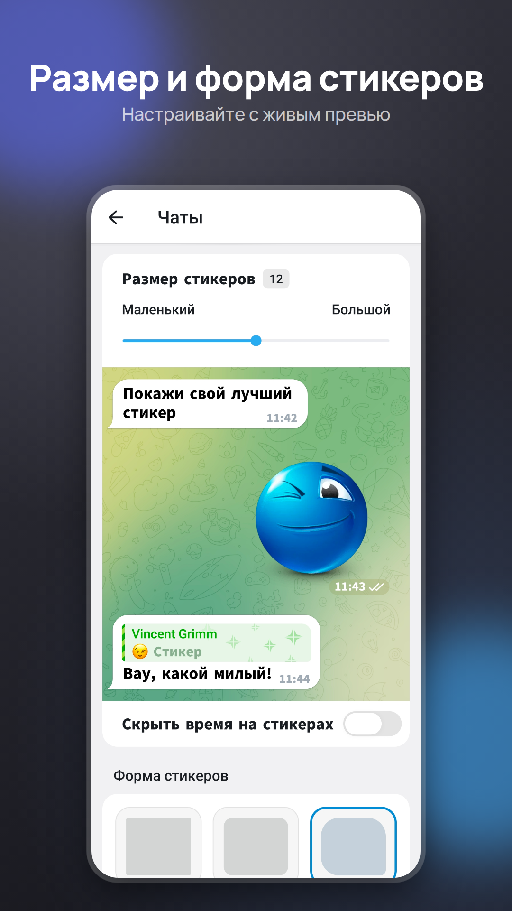
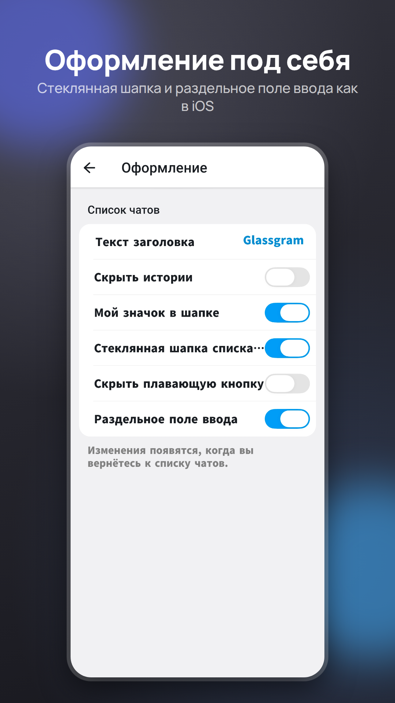
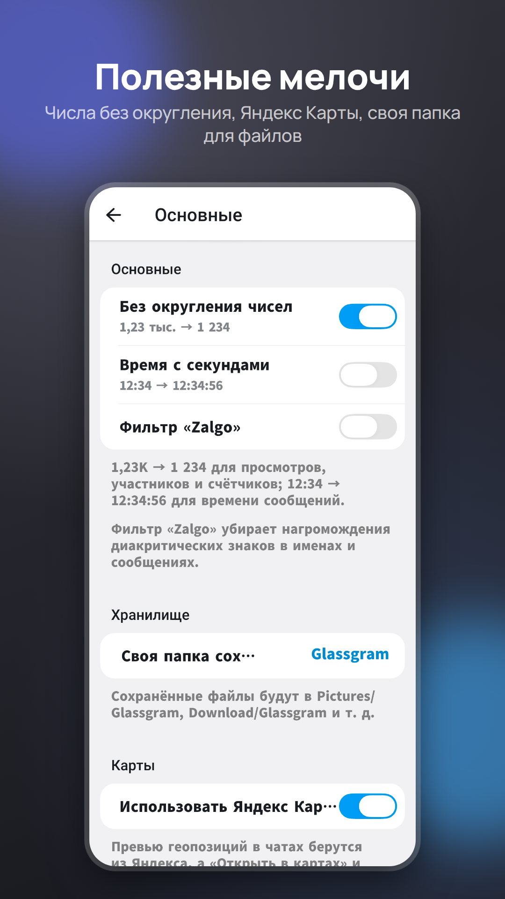

<div align="center">


<h1>glassGram</h1>

<b>Telegram. Through glass.</b>

Неофициальный клиент Telegram для Android с интерфейсом Liquid Glass,<br>
расширенной кастомизацией, собственным музыкальным плеером и Python-плагинами.

<i>An unofficial Telegram client for Android with Liquid Glass, extensive customization, a redesigned music player and Python plugins.</i>

[](https://github.com/shashachkaaa/Glassgram/releases/latest)
[](#установка)
[](https://github.com/DrKLO/Telegram)
[](LICENSE)

[](https://github.com/shashachkaaa/Glassgram/releases/latest)
[](https://t.me/glassgramdev)
[](https://t.me/glassGramReleases)

[](https://github.com/shashachkaaa/Glassgram/stargazers)
[](https://github.com/shashachkaaa/Glassgram/forks)
[](https://github.com/shashachkaaa/Glassgram/actions/workflows/build-apk.yml)
[](https://github.com/shashachkaaa/Glassgram/releases)

[Возможности](#возможности) · [Редакции](#редакции) · [Установка](#установка) · [Сборка](#сборка) · [Лицензия](#лицензия)

</div>

---

## Интерфейс

<div align="center">
  
  
  
  
  
  
</div>

<p align="center"><sub>Фирменные промоматериалы редакции RuStore. Вид интерфейса зависит от темы, настроек и устройства.</sub></p>

## Возможности

Все основные настройки клиента находятся в **Настройки → glassGram**. Возможности зависят от редакции, версии Android и поддержки устройства.

### 🫧 Liquid Glass и внешний вид

- Стеклянная шапка списка чатов и альтернативная компоновка в стиле iOS.
- Liquid Glass в меню, диалогах и нижних панелях на поддерживаемых устройствах.
- Раздельное поле ввода со стеклянными кнопками вложений и отправки.
- Нижняя навигационная капсула: выбор и перестановка вкладок «Чаты», «Контакты», «Звонки», «Профиль» и «Настройки».
- Переходы между экранами в стиле iOS.
- Собственный текст заголовка, скрытие историй, кнопки создания сообщения, собственного бейджа и сезонного таймера.
- Семь встроенных семейств шрифтов: Roboto, Inter, Golos, Onest, Manrope, Nunito и JetBrains Mono; системный шрифт и импорт собственных TTF/OTF. Для смены шрифта требуется перезапуск.
- Фирменные значки приложения и сезонное оформление: гирлянды, зимние декорации и обратный отсчёт.

### 🎵 Музыкальный плеер

- Собственный полноэкранный плеер и мини-плеер вместо стандартного интерфейса Telegram.
- Адаптивная палитра по обложке трека.
- Онлайн-тексты песен при их наличии.
- Изменение скорости с сохранением высоты тона или с её изменением, эффект реверберации.
- Возможность вернуться к стандартному плееру.

### 💬 Чаты и сообщения

- Настройка размера и формы стикеров с предпросмотром, скрытие времени на стикерах, расширенный список недавних стикеров.
- Скрытие приветственных стикеров и реакций отдельно для личных чатов, групп и каналов.
- Скрытие клавиатуры при прокрутке и кнопки выбора отправителя.
- Настраиваемое действие двойного нажатия на сообщение.
- Выбор и перестановка пунктов контекстного меню сообщений.
- Пузыри без хвостиков, значок редактирования, индикатор онлайна, мини-аватарки отправителей в группах.
- Счётчик пересылок, скрытие кнопки «Поделиться», автоматическая запятая после упоминания.
- Просмотр текста и callback data кнопок ботов.
- Фильтры сообщений, общие списки фильтров и скрытие сообщений заблокированных пользователей.

### 🧮 Inline Results

Встроенные вычисления в поле сообщения без перехода в стороннее приложение:

- Калькулятор с математическими выражениями.
- Конвертация валют и единиц измерения.
- Работа с часовыми поясами.
- Настройки группировки разрядов, градусов/радиан, валюты по умолчанию и системы измерений.

### 📷 Фото, видео и голосовые сообщения

- HD-фото по умолчанию и скрытие камеры в меню вложений.
- Предпочтение исходного качества видео, настройка интервала перемотки двойным нажатием.
- Включение звука клавишами громкости и автоматическая пауза отдельно для видео, голосовых и видеосообщений.
- Локальная расшифровка голосовых и видеосообщений с выбором языка и модели.
- Расширенные настройки записи кружков: выбор камеры, 60 FPS, стабилизация, выравнивание горизонта, повышенное качество, широкоугольная камера и сохранение зума. Доступность зависит от аппаратной поддержки.

### 👻 Режим призрака · Full

- Единый переключатель с пятью отдельно настраиваемыми параметрами: отметки прочтения сообщений, просмотры историй, статус онлайн, индикатор набора текста и автоматический уход в офлайн.
- Чтение при взаимодействии, отложенная отправка и режимы отправки без звука.
- Предупреждение перед открытием непросмотренных историй.

Настройки отметок и статусов клиента не гарантируют абсолютной невидимости: поведение сервиса зависит от Telegram и других активных сеансов.

### 🗂️ История сообщений («Шпион») · Full

- Локальное сохранение удалённых сообщений и истории редактирования.
- Настраиваемая прозрачность и отметка удалённого сообщения.
- Отдельные параметры сохранения вложений, сообщений ботов, даты прочтения и последнего визита.
- Лимит хранилища, экспорт, импорт и очистка данных.
- Дополнительные параметры обработки защищённого и исчезающего контента, отключённые в RuStore.

Уважайте приватность собеседников: не сохраняйте и не распространяйте чужой конфиденциальный или исчезающий контент без согласия. Некоторые настройки Full могут противоречить условиям Telegram API.

### 🔒 Конфиденциальность и управление данными

- Блокировка и скрытие чатов с PIN-кодом; биометрическая разблокировка на совместимых устройствах.
- Скрытие собственного номера телефона в интерфейсе.
- Резервное копирование и восстановление настроек клиента.
- Управление отправкой статистики, ручная отправка отчётов разработчикам.

### 🧩 Плагины

- Движок Python-плагинов на базе [exteraGram](https://github.com/exteraSquad/exteraGram), SDK **1.4.6.5**.
- Встроенный каталог, поиск, управление установленными плагинами, компактное и расширенное представление списка.
- Установка файлов `.plugin`, страницы настроек, пункты меню, журнал и зависимости из PyPI.
- Хуки запросов, обновлений, исходящих сообщений и методов Java.
- Совместимость с частью существующих плагинов exteraGram; не все плагины и API сторонних клиентов поддерживаются.

Плагины выполняют сторонний код внутри клиента. Устанавливайте их только из источников, которым доверяете.

[Подробнее о переносе движка и ограничениях SDK](branding/exteragram-plugins-port.md) · [Python SDK](plugins-pysdk)

### 🏷️ Бейджи и оформление профилей

- Фирменные значки рядом с именами пользователей, ботов, чатов и каналов.
- Адаптация цвета под тему и имя, анимация частиц, локализованные описания.
- Бейджи команды, участников сообщества и тестировщиков.
- Сезонные украшения профилей и аватаров.

[Документация API бейджей](glassgram-api/README.md)

### ⚙️ Общие настройки и производительность

- Точное время с секундами, числа без сокращений и относительное отображение последней активности.
- Фильтрация Zalgo-текста.
- Отображение Telegram/Bot API ID и дата-центра.
- Выбор папки для сохранённых файлов и Яндекс Карт.
- Настраиваемое ускорение загрузки и выгрузки.
- В Full: дополнительные сетевые настройки и встроенное подключение на базе Xray/VLESS, отключение рекламы и дополнительные настройки опросов.
- Статистика кадров и диагностика рывков интерфейса на Android 12+.

## Редакции

| Возможность | Full | RuStore |
| :--- | :---: | :---: |
| Liquid Glass, кастомизация, плеер и шрифты | ✅ | ✅ |
| Python-плагины | ✅ | ✅ |
| Inline Results и локальная транскрипция | ✅ | ✅ |
| Бейджи, фильтры, блокировка чатов | ✅ | ✅ |
| Режим призрака и история удалённых сообщений | ✅ | — |
| Дополнительные настройки защищённого контента, рекламы и опросов | ✅ | — |
| Встроенные сетевые возможности glassGram | ✅ | — |
| Обновление APK из приложения | ✅ | — |

## Установка

| Сборка | Где скачать |
| :--- | :--- |
| **Full · стабильная** | [Последний релиз](https://github.com/shashachkaaa/Glassgram/releases/latest) |
| Full · тестовая | [latest](https://github.com/shashachkaaa/Glassgram/releases/tag/latest) |
| RuStore · сборка из master | [latest-rustore](https://github.com/shashachkaaa/Glassgram/releases/tag/latest-rustore) |
| Все версии | [Архив релизов](https://github.com/shashachkaaa/Glassgram/releases) |

Требования: Android 6.0 (API 23) и новее; Python-плагины — Android 7.0 (API 24) и новее. Некоторые визуальные эффекты и функции камеры требуют более нового устройства.

Стабильные APK собираются для ARM64 и ARMv7 с R8. Обычные тестовые сборки из `master` — ARM64 без R8. Для обновления поверх установленного приложения APK должен иметь совместимую подпись.

## Сборка

Клиент основан на [официальных исходниках Telegram для Android](https://github.com/DrKLO/Telegram). Основной язык — Java/Kotlin; Python используется в движке плагинов.

**Окружение:** JDK 21, Android SDK 36, Build Tools 36.0.0, NDK 27.2.12479018, CMake 3.22.1 и Python 3.11.

```bash
git clone --recursive --shallow-submodules https://github.com/shashachkaaa/Glassgram.git
cd Glassgram
```

Для использования собственных API-реквизитов задайте переменные окружения `APP_ID` и `APP_HASH`, полученные на [my.telegram.org/apps](https://my.telegram.org/apps). Не публикуйте секреты и ключи подписи.

```bash
# Full
./gradlew :TMessagesProj_App:assembleAfatRelease

# RuStore
./gradlew :TMessagesProj_App:assembleAfatRelease -PGLASSGRAM_STORE=true
```

Для полного воспроизведения CI, включая сборку libXray, подмодули, подпись и упаковку SDK плагинов, используйте [build-apk.yml](.github/workflows/build-apk.yml). Сборка с собственной подписью не заменяет официально подписанный APK без переустановки.

### Структура проекта

| Каталог | Назначение |
| :--- | :--- |
| [TMessagesProj](TMessagesProj) | Основной код клиента и нативные библиотеки |
| [TMessagesProj_App](TMessagesProj_App) | Android-приложение |
| [TMessagesProj_LiquidGlass](TMessagesProj_LiquidGlass) | Компоненты Liquid Glass на Compose и Backdrop |
| [plugins-pysdk](plugins-pysdk) | Python SDK плагинов |
| [glassgram-api](glassgram-api) | Конфигурация и документация API бейджей |
| [branding](branding) | Логотипы, оформление и промоматериалы |

## Обратная связь

Нашли ошибку? Откройте [Issue](https://github.com/shashachkaaa/Glassgram/issues/new), указав версию клиента, модель устройства, версию Android и шаги воспроизведения. Не прикладывайте токены, номера телефонов, содержимое личной переписки и другие чувствительные данные.

Предложения и вклад в проект приветствуются: [Issues](https://github.com/shashachkaaa/Glassgram/issues) · [Pull requests](https://github.com/shashachkaaa/Glassgram/pulls).

Отправка диагностической статистики включена по умолчанию и регулируется в настройках glassGram. Статистика включает сведения о версии приложения, устройстве, количестве аккаунтов и используемых функциях; часть возможностей зависит от сервисов проекта.

## Лицензия и благодарности

glassGram — независимый неофициальный клиент, не связанный с Telegram FZ-LLC и не одобренный Apple или авторами exteraGram.

- [Telegram for Android](https://github.com/DrKLO/Telegram) — исходная основа (GNU GPL v2 или новее).
- [exteraGram](https://github.com/exteraSquad/exteraGram) — движок плагинов и Python SDK; см. [дополнительные условия](ADDITIONAL_TERMS.md).
- Backdrop / Liquid Glass (`io.github.kyant0:backdrop`) — библиотека эффектов.
- [Vosk](https://github.com/alphacep/vosk-api) — локальное распознавание речи.
- [XTLS/libXray](https://github.com/XTLS/libXray) — сетевой компонент Full.

Код glassGram распространяется под [GNU GPL v3 или новее](LICENSE). Сторонние компоненты сохраняют собственные лицензии.

[Telegram API](https://core.telegram.org/api) · [MTProto](https://core.telegram.org/mtproto)

---

<div align="center">
  
  <br>
  <b>glassGram</b><br>
  <sub>Open source. Built on Telegram.</sub><br><br>
  <a href="https://t.me/glassgramdev">Telegram</a> ·
  <a href="https://github.com/shashachkaaa/Glassgram/releases">Releases</a> ·
  <a href="https://github.com/shashachkaaa/Glassgram">GitHub</a>
</div>
